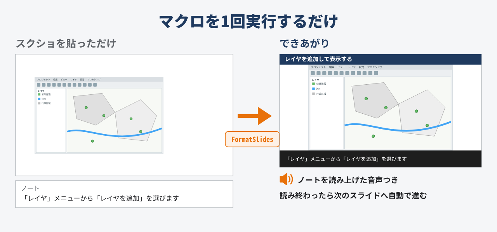
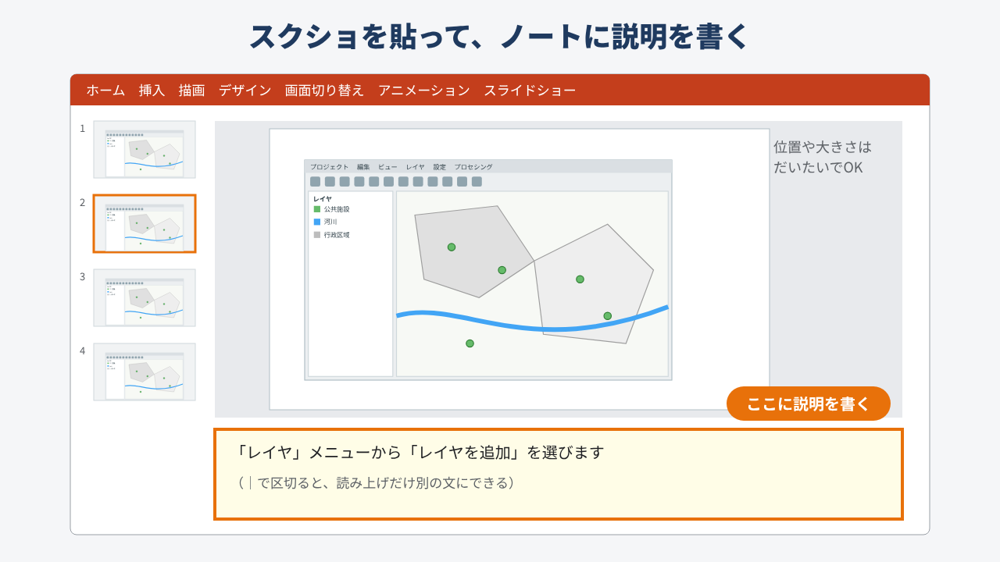

# ppt-screenshot-manual-video

**スクショを貼るだけで、字幕と読み上げ付きの操作マニュアル動画を作る PowerPoint マクロ**

画面録画も、自分の声の録音もいりません。
スクショを貼ったスライドのノートに説明を書いてマクロを実行すると、タイトル・字幕・読み上げ音声・自動の画面切り替えが付き、そのまま mp4 に書き出せます。
PowerPoint と Windows に最初から入っている機能だけで動くので、ソフトを自由に入れられない職場の PC でも使えます。

## できあがるスライド

- **上**：何の操作かを示す共通タイトル
- **真ん中**：スクショ（位置や大きさは自動で調整）
- **下**：ノートに書いた説明の字幕
- スライドショー・動画では、ノートの文を読み上げ、読み終わったら次のスライドへ自動で進みます

## マクロ一覧

| マクロ | やること |
| --- | --- |
| `FormatSlides` | スクショを貼ったスライドを整える（タイトル・字幕・読み上げ音声・切り替え）。説明やタイトルを直したときも、これをもう一度実行 |
| `AddRedCircle` | 表示中のスライドに赤丸を置く（位置は手で動かす） |
| `AddRedBox` | 表示中のスライドに赤四角を置く |
| `AddHighlights` | 置いた赤丸・赤四角に「フェードで出現 → 3回点滅」のアニメを一括で付ける |
| `ExportVideo` | 保存したファイルと同じ場所に mp4（1080p）を書き出す |

## 使い方

### 1. マクロを入れる

1. PowerPoint で `Alt` + `F11` を押し、「挿入」→「標準モジュール」を選ぶ
2. `手順スライド作成マクロ.txt` の中身を全部コピーして貼り付ける
3. 「PowerPoint マクロ有効プレゼンテーション（.pptm）」で保存する

> [`手順スライド作成マクロ.txt`](手順スライド作成マクロ.txt) を開いて中身をコピーしてください。`.bas` ファイルとしてインポートすると、日本語が文字化けすることがあります。
> マクロ入りの .pptm をひな形にして、毎回コピーして使うと楽です。

### 2. 素材を用意する

1. 白紙のスライドに、`Win` + `Shift` + `S` で撮ったスクショを `Ctrl` + `V` で貼る
2. そのスライドの「ノート」欄に、その手順の説明を書く
3. これを手順の数だけ繰り返す

ノートに `画面の文｜読み上げる文` と書くと、字幕と読み上げを別の文にできます（`｜` は全角・半角どちらでも可）。縦線がなければ、両方同じ文になります。

### 3. マクロを実行する

`Alt` + `F8` でマクロの一覧を出し、次の順に実行します。

1. `FormatSlides`：最初の1回だけ、共通タイトルを聞かれます
2. `AddRedCircle` / `AddRedBox`：押す場所に赤丸・赤四角を置く（必要なスライドだけ）
3. `AddHighlights`：赤丸・赤四角にアニメを付ける
4. `ExportVideo`：mp4 に書き出す（先にファイルを保存しておく）

### 直したいとき

- **説明を直す**：ノートを書き換えて `FormatSlides` をもう一度実行
- **タイトルを変える**：一番上のスライドのタイトルバーの文字を直して `FormatSlides` を実行
- **赤丸を動かす・足す**：直してから `AddHighlights` をもう一度実行

どのマクロも、何度実行しても重複しないようになっています。

## 設定

コード冒頭の「設定」の数字を書き換えると調整できます。

| 定数 | 内容 | 初期値 |
| --- | --- | --- |
| `VOICE_RATE` | 読み上げの速さ（-10～10） | 1 |
| `PAD_SEC` | 読み上げが終わってから次へ進むまでの余白（秒） | 1 |
| `NO_VOICE_SEC` | ノートが空のスライドの表示秒数 | 4 |
| `MIN_SEC` | 1枚の最低表示時間（秒） | 5 |
| `TITLE_H` / `TITLE_SIZE` | タイトルバーの高さ / 文字サイズ | 50 / 24 |
| `CAPTION_H` / `CAPTION_SIZE` | 字幕の高さ / 文字サイズ | 80 / 22 |
| `FONT_NAME` | フォント | メイリオ |
| `HL_DELAY` | スライドが出てから赤丸が出るまで（秒） | 1 |
| `HL_REPEAT` | 赤丸の点滅回数 | 3 |
| `HL_LINE` | 赤丸・赤四角の線の太さ | 4 |

## 動作環境

- Windows 版 PowerPoint（Microsoft 365 を想定）
- 日本語の音声合成（Windows 標準の Haruka など）
- マクロの実行が許可されていること（職場の設定で止められている場合があります）

## 注意

- 読み上げは Windows 標準の音声合成なので、少し機械的な声です。英字や記号の読み方がおかしいときは、`｜` の右側（読み上げ用）をカタカナで書いてください。
- 使う前に、コピーしたファイルで試してください。利用は自己責任でお願いします。
